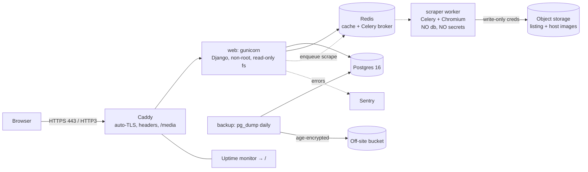

# CoHost — Production Architecture

Marketplace where Airbnb hosts find co-hosts. Django 5.2 / Postgres / Redis / Selenium scraper.

## 1. What the audit found (2026-11-15)

| # | Finding | Impact | Status |
|---|---------|--------|--------|
| 1 | `requirements.txt` was a host `pip freeze` (`dnf`, `rpm`, `cockpit`, `selinux`, `systemd-python`…) | `docker build` cannot succeed | **Fixed** – 13 direct deps |
| 2 | `redis` client missing though settings use `RedisCache` | Crash as soon as `CACHE_URL=redis://…` is set | **Fixed** |
| 3 | No `SECURE_PROXY_SSL_HEADER` | `SECURE_SSL_REDIRECT=True` behind any proxy = infinite redirect | **Fixed** (`BEHIND_PROXY`) |
| 4 | Compose published gunicorn on `:8000`, no TLS proxy in the stack; `nginx.conf` not wired in | Plain HTTP on the internet | **Fixed** – `docker-compose.prod.yml` + Caddy |
| 5 | Secrets only as env vars / `.env` | Visible in `docker inspect`, `/proc`, crash dumps | **Fixed** – `*_FILE` secrets (§5) |
| 6 | 1,161 `node_modules` files, `__pycache__`, `.claude/settings.local.json` tracked in git | Repo bloat, leaks local tooling config | **Untracked** (files kept on disk; not yet committed) |
| 7 | Hard-coded LAN IP in `CSRF_TRUSTED_ORIGINS` | Prod origin impossible without code edit | **Fixed** (env) |
| 8 | Container ran as root, logged to files | No hardening, logs lost on container restart | **Fixed** – uid 10001, stdout logging |
| 9 | Scraper = `subprocess.run(..., timeout=300)` in the request, gunicorn `timeout=30` | Worker killed at 30 s; one slow scrape ties up a worker | **Mitigated** (`GUNICORN_TIMEOUT=330`); real fix = Phase 6 (§3) |
| 10 | User uploads (`media/`) tracked in git and stored on local disk | Not horizontally scalable; PII (host photos) in history | Open – move to object storage (§4), `git rm --cached media/` |
| 11 | No tests (`tests.py` empty), no CI | Regressions ship | Open – Phase 7 |
| 12 | `cookies.txt` (local curl session), `db.sqlite3` in working dir | Untracked, never committed (`git log --all` clean) | OK – delete locally |

`.env` was **never committed**, so no key rotation is forced by history.

## 2. Target architecture



Two Docker networks: `edge` (Caddy ⇄ web, plus egress for SMTP/Sentry) and `backend`
(`internal: true`: Postgres, Redis, backup have **no route to the internet**).

### Why these choices
- **Caddy over nginx** – automatic Let's Encrypt issuance/renewal, HTTP/3, 10-line config, no certbot cron.
- **Postgres + Redis, not SQLite** – concurrent writes, atomic rate-limit counters (`django-ratelimit` needs them).
- **Scraper as an isolated worker (the creative part)** – the scraper drives a real browser against
  untrusted web pages: the highest-risk component. In Phase 6 it becomes its own image/container that
  receives *a URL* and returns *JSON + image bytes*; it has no DB password, no `SECRET_KEY`, and its only
  credential is a write-only object-storage key. A browser exploit then yields nothing worth stealing.
  The existing SSRF guard (`_validate_scraper_url`) stays as the first gate; add an egress allow-list
  (`*.airbnb.*`, image CDNs) on the scraper network as the second.
- **Async UX** – `add_listing` returns immediately with a "Importing…" card that polls `/listings/<id>/status`.
  Fixes finding 9 and removes the 300 s worker hold.

## 3. Roadmap

| Phase | Work | Size |
|-------|------|------|
| **0 – now** | This setup: clean deps, `setup.sh`, prod compose, secret files | done |
| **1** | Commit; `git rm --cached media/`; create the VPS (§6); `./setup.sh prod` | 1 h |
| **6** | Celery scrape task + status polling + separate `scraper` image target (stub already in compose) | 1–2 days |
| **7** | pytest-django: models, permissions (host vs co-host), proposal state machine, reviews; GitHub Actions: ruff → pytest → build → Trivy → push to GHCR | 1–2 days |
| **8** | `django-storages` → S3-compatible bucket (R2/Backblaze/Scaleway); EXIF-strip on upload; signed URLs for private files | 1 day |
| **9** | Structured JSON logs → Loki/Better Stack; Sentry release tags; uptime check | ½ day |

### Where to host (pick by stage)
1. **Single VPS (Hetzner/Scaleway, 2 vCPU/4 GB ≈ €5–8/mo)** – this repo, as-is. Recommended start.
2. **Managed PaaS (Fly.io / Render)** – once media is in object storage, web becomes stateless; use managed Postgres.
3. Kubernetes – not justified at this size.

## 4. Data classification

| Data | Sensitivity | Where it lives | Protection |
|------|-------------|----------------|------------|
| Passwords | High | Postgres (`auth_user`, PBKDF2) | Never logged; Django hashers |
| Messages / proposals | High (private) | Postgres | Access checked per-participant in views; DB backups encrypted |
| Emails, names, profile photos | PII | Postgres + bucket | `send_default_pii=False` for Sentry; privacy policy page exists |
| Scraped listing data/images | Low–medium | Postgres + bucket | Public by design |
| Secrets (§5) | Critical | tmpfs files | below |

## 5. Secure hosting of sensitive data

**Principle: a secret exists in plaintext in as few places as possible, and never in git, images, env vars or logs.**

### Layer 1 – at runtime: secrets are files, not env vars  *(implemented)*
`docker-compose.prod.yml` mounts `./secrets/*` as Docker secrets → `/run/secrets/<name>` (an in-memory tmpfs
inside the container). Django reads them through `env('NAME')` in `settings.py`, which honours `NAME_FILE`.
Postgres reads `POSTGRES_PASSWORD_FILE`; Redis reads its password at start. Nothing sensitive appears in
`docker inspect`, `ps e`, `/proc/*/environ`, or the image layers. Only non-secret config is in `.env.prod`.

### Layer 2 – generated, never typed
`./setup.sh secrets <domain> <email>` creates `secrets/` (mode 700, files 600) with a 64-byte `SECRET_KEY`
and 192-bit DB/Redis passwords from Python's `secrets` module. It never overwrites an existing file.
`secrets/`, `.env`, `.env.*` are git- and docker-ignored; `./setup.sh check` fails if any are tracked.

### Layer 3 – at rest and in git (pick one)
**A. SOPS + age (recommended: free, no server, lets the secrets live in git safely)**
```bash
age-keygen -o ~/.config/sops/age/keys.txt            # keep this key OFF the repo; back it up in your password manager
# .sops.yaml:  creation_rules: [{path_regex: secrets/.*, age: <your age1... public key>}]
tar cf - secrets | sops --encrypt --input-type binary --output-type binary /dev/stdin > secrets.enc   # commit this
# on the server (key is the only thing you copy by hand):
sops --decrypt secrets.enc | tar xf -  && chmod -R go-rwx secrets
```
Only ciphertext is committed; a leaked repo reveals nothing. Rotate = re-run, commit, redeploy.

**B. Managed secret store** – Doppler / Infisical / AWS Secrets Manager / Vault: `doppler run -- docker compose …`
or a deploy step that writes the files. Choose this if more than ~3 people deploy.

### Layer 4 – rotation & blast radius
- `SECRET_KEY`: put the old key in `SECRET_KEY_FALLBACKS` (implemented) so rotating doesn't log everyone out.
- Postgres/Redis passwords: change the file + `ALTER USER`, `docker compose up -d`.
- Separate credentials per component; the future scraper holds **only** a write-only bucket key.
- Email: use an app password/API key for a dedicated sender, not a personal mailbox password.

### Layer 5 – the host itself
- Firewall: allow only 22 (key-only SSH, `PasswordAuthentication no`), 80, 443. Postgres/Redis are not published.
- `unattended-upgrades`, `fail2ban`; disk encryption at the provider if offered.
- Backups: daily `pg_dump` (in compose, 7 daily/4 weekly/6 monthly) → copy off-site **encrypted**:
  `… | age -r <public-key> | rclone rcat remote:cohost-backups/$(date +%F).sql.age`. Test a restore quarterly.
- Admin: put `/admin/` behind Caddy `basic_auth`/IP allow-list and enable 2FA (`django-otp`) before launch.

### Do not
Commit `.env`/`secrets/`; paste secrets in issues/CI logs; reuse the dev `SECRET_KEY` in prod; keep
`cookies.txt`/`db.sqlite3` with real sessions around (delete them locally).

## 6. First deploy checklist
1. VPS + DNS `A` record for the domain → server IP.
2. `git clone … && cd airbnb_scraper && ./setup.sh prod cohost.example.com you@example.com`
3. Fill `secrets/email_host_password`, `secrets/sentry_dsn`, `EMAIL_HOST*` in `.env.prod`; `docker compose … up -d`.
4. `docker compose -f docker-compose.prod.yml --env-file .env.prod exec web python manage.py createsuperuser`
5. Visit `https://<domain>`; once stable set `SECURE_HSTS_SECONDS=31536000` in `.env.prod`.
6. Encrypt `secrets/` with SOPS (Layer 3A) and store the age key offline.

> `nginx.conf` is superseded by `Caddyfile` and can be deleted. `docker-compose.yml` remains the dev/Postgres-local stack.
